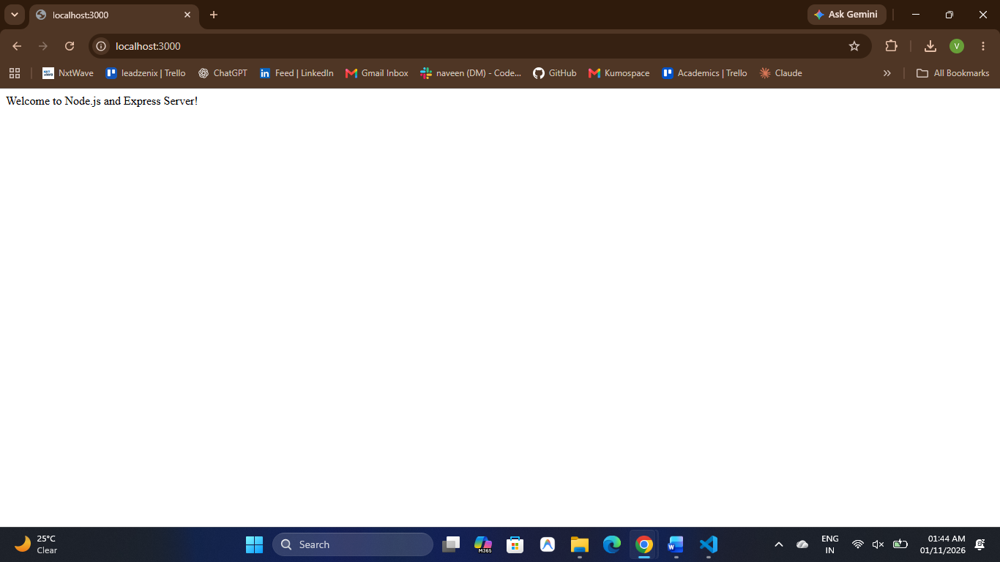
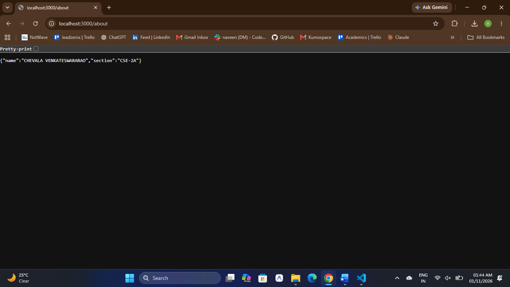

# Lab 01: Node.js and Express Server

**Student Name:** CHEVALA VENKATESWARARAO  
**Registration Number:** YOUR_REGISTRATION_NUMBER  
**Section:** CSE-2A

## Live Deployment

**Live URL:** To be added after Render deployment.

## Project Description

This project demonstrates the fundamentals of backend development using Node.js and Express.js. It includes creating a basic HTTP server using Node.js's built-in HTTP module and an Express server to handle HTTP GET requests, return responses, and manage unknown routes.

## Technologies Used

- Node.js
- Express.js
- JavaScript
- npm
- GitHub
- Render

## Installation

Install the project dependencies:

```bash
npm install
```

## Running the Project

Run the Express server:

```bash
npm start
```

Run the native Node.js HTTP server separately:

```bash
node basic-server.js
```

## API Endpoints

| Method | Endpoint | Description |
|---|---|---|
| GET | `/` | Returns a welcome message |
| GET | `/about` | Returns student name and section in JSON format |
| GET | `/time` | Returns the current date and time |
| GET | `/unknown` | Demonstrates 404 error handling |

## Screenshots

### Basic Node.js HTTP Server


### Home Endpoint



### About Endpoint



### Time Endpoint


### 404 Endpoint


## Learning Outcomes

- Understood how to create an HTTP server using Node.js.
- Learned how to initialize an Express application.
- Understood HTTP GET request methods and route handling.
- Learned how to send text and JSON responses.
- Understood request and response objects.
- Learned how to generate the current date and time using `new Date()`.
- Understood HTTP status codes, including 200 and 404.
- Learned how to deploy a Node.js application using Render.

## Problems Faced and Solutions

1. **Port Configuration for Cloud Deployment**
   - *Problem:* Using a fixed port can cause deployment issues because cloud hosting platforms assign their own port.
   - *Solution:* Used `const PORT = process.env.PORT || 3000;` to support both Render deployment and local development.

2. **404 Catch-All Route Handling**
   - *Problem:* Incorrect placement of the 404 middleware can cause valid routes to return 404 responses.
   - *Solution:* Placed the 404 handler after all the defined GET routes.

3. **Handling JSON Responses**
   - *Problem:* Returning structured student information requires an appropriate JSON response.
   - *Solution:* Used `response.status(200).json()` to return student details in JSON format.